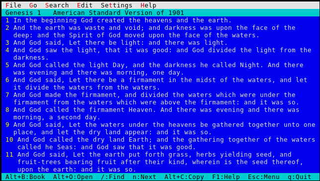
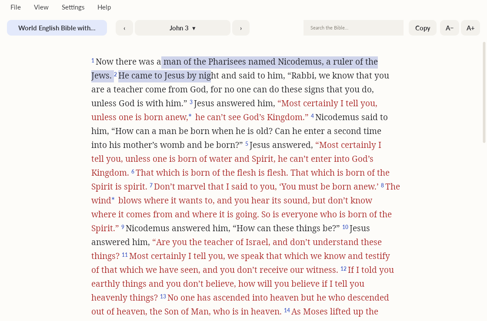
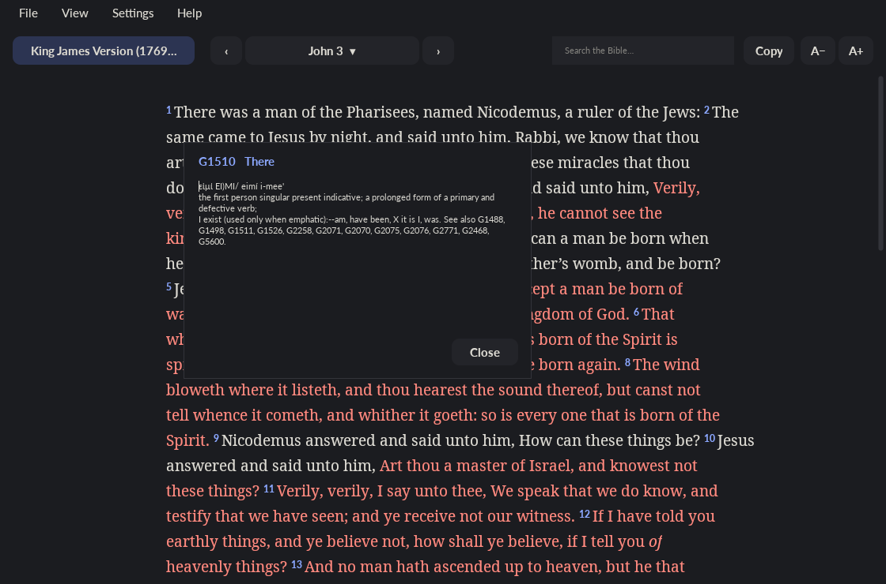
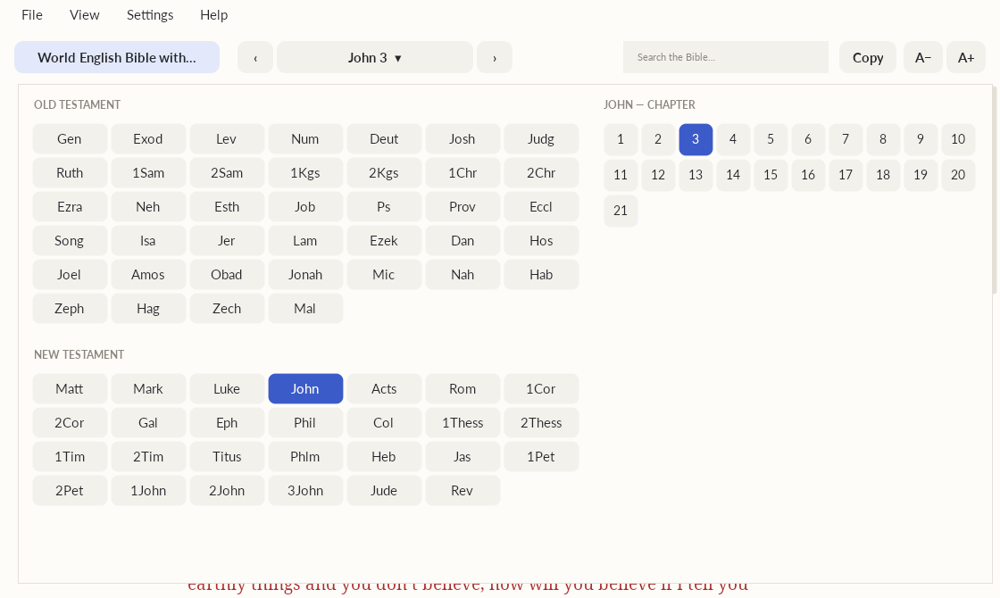

# mkbible

Bible module objects for Free Pascal (Turbo Pascal style `Object` types, in the manner of MKMsgAbs), the
tools built on them, and `mkbible`, a text mode Bible reader.

## Formats

| Kind | Formats |
|---|---|
| Bibles | Sword (zText, RawText, LZSS / ZIP / bzip2, ciphers; no Apocrypha books, see License), MySword, theWord, STEP / QuickVerse, verse-per-line `.vpl`, OSIS, Zefania XML (and Haggai XML), USFX, USFM and USX 2 / 3 (folder or zip), Beblia XML, Unbound Bible text |
| Dictionaries | Sword zLD, MySword `.dct.mybible`, theWord `.dct.twm` |
| Commentaries, books | theWord `.cmt.twm`, `.gbk.twm` |

The markup translator (`MKBibMkp`) converts verse text between OSIS, ThML, GBF, MySword, theWord, STEP RTF,
USFM, USFX, USX, Zefania, HTML, TEI and plain text, keeping notes, headings, italics, words of Jesus, cross
references, Strong's numbers and morphology wherever the target can carry them.

## Programs (`./build.sh`, output in `build/`)

* `mkbible` - the reader: always visible menu bar, Left/Right for chapters, Alt+B book and chapter lists,
  Alt+O module list from configured paths, Alt+C copy, `/` search (plain or regular expression), colors.
* `bibconv`, `dictconv` - convert modules between formats.  `bibdump`, `bibtest`, `bibimp`, `dicttest`,
  `comtest`, `boktest` - inspect and build modules.  `bibmk` - try the markup translator.
* `tools/regress.sh` - the regression suite: checks against Sword's own `mod2imp`, `diatheke` and
  `vpl2mod`, independent Python readers, and round trips.  Checks that need sample files on the
  author's machine are skipped when the files are not there.

Build with `make` (or `./build.sh`); `make install` puts `mkbible`, `bibconv`, `dictconv`, `bibimp`, `bibdump` and `bibmk` (and `mkbiblegui`, if `make gui` built it) in
`$(PREFIX)/bin` (default `/usr/local`; `DESTDIR` works for packaging), `make uninstall` removes them, `make deb` builds a Debian package (`build/mkbible_<version>_<arch>.deb`, with `mkbiblegui`
and its menu entry when it was built), `make check` runs the regression suite.

Needs Free Pascal 3.2 and `libsqlite3` at run time (MySword, theWord).  `NOTES` on formats that were looked at and
left alone (vendor-protected libraries) are not part of this repository.

## The mkbible reader

`mkbible [module]` is a small text mode Bible reader for a terminal (about 80x24 or larger). The menu bar and a
key hint line are always visible, so nothing has to be remembered. It reads any module the library can open:
Sword, MySword, theWord, STEP, VPL, OSIS, Zefania / Haggai, USFX, USFM, USX, Beblia and Unbound. Without an argument it resumes at the
module, book and chapter where you left off.

| Key | Action |
| --- | --- |
| Left / Right | previous / next chapter |
| Up / Down / PgUp / PgDn / Home / End | scroll the chapter |
| Alt+B | pick a book (all 66), then a chapter |
| Alt+O | pick a module from the configured module paths |
| Alt+C | copy the chapter to the system clipboard, to paste into other programs |
| `/` | search the whole Bible, a testament or the current book; the hits are listed, plain text or regular expression |
| n / N (F3 / Shift+F3) | next / previous hit |
| F10 or Esc, Alt+letter | the menu bar (File, Go, Search, Edit, Settings, Help) |
| F1 | key list |
| q | quit |

Module paths are added, edited (Enter) and deleted (Delete key) under File, Module Paths..., and Settings, Colors...
changes the screen colors. Searches highlight the matches in the text. The configuration is kept in
`~/.config/mkbible/mkbible.cfg`.

## The mkbiblegui reader

`mkbiblegui` is a graphical reader on the same Bible objects, drawn with BGRABitmap / BGRAControls on Lazarus: a
a book and chapter picker (one pop-up with every book and chapter on screen), a centered reading column in a serif face with red letters, italics, headings
and small verse numbers, and light and dark themes. It opens the same modules as `mkbible` and shares its module
folders (`~/.config/mkbible/mkbible.cfg`, `%APPDATA%\mkbible` on Windows).

* **Go to:** the button next to the arrows (or Ctrl+G) opens every book as a grid, with the chapters of the chosen book
  beside it: two clicks (one for single-chapter books) to any chapter.
* **Select and copy:** drag across the text (or double-click a word) and press Ctrl+C or the Copy button; with nothing
  selected the whole chapter is copied. Settings, Copy with verse numbers: on / off chooses whether numbers are included.
* **Strong's numbers:** in a module that carries them (the Sword KJV with Strong's, for example) words with a number
  are underlined under the mouse, and a click opens a pop-up with the Greek or Hebrew dictionary entry. The Sword
  StrongsGreek / StrongsHebrew modules are found on the module folders, or pick others under Settings.
* **Notes:** footnotes (*) and cross references (†) are marked in the text; a click opens a pop-up with the note or the
  referenced verses. View, Hide cross references (Ctrl+R) removes the † marks, and the choice is remembered.
* **Download modules:** Settings, Download modules... lists what is available from the built in repositories
  (CrossWire main, beta, attic and Wycliffe, eBible.org as Sword modules, and eBible.org's USFM Bibles), with a filter
  box, and installs the chosen one. Sword modules go into `~/.sword` (`%APPDATA%\Sword` on Windows) and USFM Bibles
  into `~/.local/share/mkbible/modules`; either folder is added to the module folders when needed. Locked modules
  (those that need a purchased key) are not listed. More repositories can be added to `mkbible.cfg` as
  `repo.1 = Name | sword | https://host/path` (or `ebible` for an eBible.org style Scriptures folder). Downloads use
  HTTPS, so OpenSSL (`libssl`) has to be installed.
* **Search** with highlighted hits (click one to go there), **text size** (A−, A+), a **reading font** chooser, **module
  folders** editing, HiDPI scaling, and a menu bar (File, View, Settings, Help).

Build it with `make gui` (needs Lazarus 4, BGRABitmap and BGRAControls, see `gui/README.md`). The Windows build has
not been tried yet.

## Windows

The converters and `mkbiblegui` are written to build on Windows (the text mode `mkbible` reader is Unix only). Install
Lazarus (it brings the Free Pascal compiler), put `fpc` and `lazbuild` on the PATH, install the BGRABitmap and
BGRAControls packages (see `gui\README.md`) and run `build.bat gui`; `build.bat` alone builds only the command line
tools. MySword and theWord modules need a 64 bit `sqlite3.dll` next to the programs. The configuration is kept in
`%APPDATA%\mkbible`. This has not been tried on a Windows machine yet.

## License

GNU General Public License, version 3: see `LICENSE`.

Nothing in the repository is copied from Sword.  The 66 book tables (`src/MKBibVrs.pas`, from `tools/genvrs.py`) are
counted in a public domain Bible text.  The Apocrypha of the KJVA and NRSVA versifications are not included: Sword
indexes its modules by its own chapter and verse counts for them, and those tables are under version 2 of the GPL
only.  `src/MKBibVrA.pas` is therefore a stand-in with no Apocrypha books; the 66 canonical books of a Sword module
that has an Apocrypha still read and write.  `./build.sh --sword-apocrypha` writes a local `MKBibVrA.pas` from a copy
of Sword's include directory (`tools/genvra.py`) for your own use; a build with it is a combined work under version 2
and the file must not be committed or distributed.

`uScreen`, `uCP437`, `uKeys` and `uText` are shared with the MKEdit editor.
